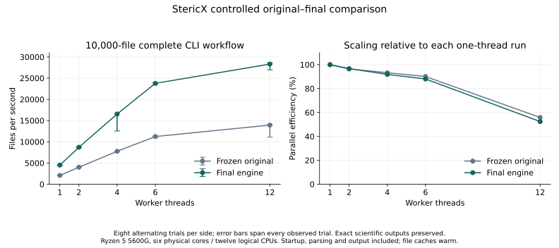

# StericX

**A Rust molecular steric-descriptor engine with explicit conformer analysis and
Python bindings.** StericX calculates Sterimol, hard-sphere buried volume and
pyramidalization, and provides a separately defined electron-density-grid
buried-volume mode. Independent comparisons, failed cases and reproducible
inputs accompany the implementation.

The [completed scientific and performance campaign](docs/ultimate_engine/FINAL_REPORT.md)
preserves existing descriptor defaults, adds explicit continuous numerical
methods, and measures **23,783.8 files/s at six threads** on the frozen
10,000-file workload, versus 11,242.0 for the matched original implementation.

[](https://github.com/AndrejRumenovski/StericX/actions/workflows/ci.yml)
[](#citation-and-license)

## Install and calculate

The checkout uses Python package version **0.4.0rc1** and Rust crate version
**0.3.0**. Build from source to include the latest engine improvements; the
archived release-candidate artifacts below predate the final optimization
campaign. With Python 3.11–3.14 and Rust 1.85 or newer installed:

```bash
python -m pip install ./python
# Optional table and RDKit adapters:
python -m pip install './python[tables,rdkit]'
```

A previously validated Linux x86-64 wheel was built and installed in isolated
Python 3.11, 3.12, 3.13 and 3.14 environments. Each installation passed 71 package tests;
a separate source-archive installation also passed. That candidate's CI passed
all 12 Python-version/OS combinations on Linux x86-64,
Windows x86-64 and macOS arm64, plus source installation. The
[release-candidate audit](docs/validation/dbstep/resolution_release/RELEASE_CANDIDATE.md)
preserves exact artifacts and source identities. The
[unpublished candidate bundle](docs/validation/dbstep/resolution_release/candidate_v1/candidate_artifacts.tar.gz)
contains three platform wheels, a source archive and checksums.

```python
from stericx import Molecule, DescriptorOptions

mol = Molecule.from_file("ligand.xyz")
options = DescriptorOptions(axis="coordination", donor_index=0)
result = mol.descriptors(options)

print(result.sterimol.require())  # L, B1, B5 in Å
print(result.buried_volume.require().summary)  # volume in ų, fraction in %
print(result.pyramidalization.require())
```

Choose the actual donor index for your geometry; indices are zero-based.
Coordination-axis Sterimol uses the inferred virtual center and the documented
+0.40 Å L correction. Bond-axis calculations require a meaningful attachment
axis. Undefined descriptors return structured errors independently, so a
failure does not silently remove a conformer.

For the standalone CLI:

```bash
cargo build --release --locked
./target/release/stericx descriptors ligand.xyz --sterimol-axis coordination --format json
./target/release/stericx --help
```

The [retained CLI guide](LEGACY_WORKFLOWS.md) covers database construction,
comparison, batch files and legacy research workflows.

## Conformers are explicit data

```python
from stericx import Ensemble, DescriptorOptions

ensemble = Ensemble.from_sdf("ligands.sdf")
results = ensemble.descriptors(DescriptorOptions(axis="coordination"))

print(results.sterimol_b5.mean)
print(results.sterimol_b5.minimum, results.sterimol_b5.maximum)
print(results.sterimol_b5.standard_deviation)  # population SD, divisor n
print(results.sterimol_b5.median)
print(results.sterimol_b5.boltzmann_mean)  # None without valid energies

for conformer in results.conformers:
    print(conformer.index, conformer.identifier, conformer.sterimol)

results.to_pandas().to_csv("conformers.csv", index=False)
```

Every input record keeps its order, identity, source geometry, properties and
failure status. Supported conformers expose L/B1/B5, total and percent buried
volume, quadrant and octant volumes, and pyramidalization. Regional results
carry their molecular frame; ensemble regional statistics require consistent
explicit atom mapping/connectivity. XYZ files alone do not establish that map.

Statistics describe the supplied finite ensemble. The default requires complete
coverage for each descriptor; an explicitly selected available-case policy
reports the retained subset and population mass. Sensitivity reports include
range, standard deviation and all conformers tied at each extreme. No universal
flexibility score is imposed.

Boltzmann weighting requires explicit comparable energies, units, provenance,
energy kind, temperature, state degeneracy and assumptions. Electronic or
force-field energy weighting is labelled accordingly; it is not silently called
a free-energy population. Missing energies never produce invented uniform
Boltzmann populations. The
[API and mathematical definitions](docs/paton_recommendations/CONFORMER_API.md)
and [executed notebook](python/examples/stericx_research.ipynb) show the complete
workflow, including recorded MMFF energies, RDKit, NumPy/pandas, batch errors and
sensitivity exports.

## Density grids and radius profiles

```python
from stericx import DensityGrid

grid = DensityGrid.from_cube(
    "density.cube",
    field="total_electron_density",
    density_unit="electrons_per_bohr_cubed",
    provenance="Your calculation method, basis, state and source file",
)
profile = grid.buried_volume_scan(
    [2.0, 2.5, 3.0],
    center_angstrom=(0.0, 0.0, 0.0),
    threshold_electrons_per_bohr3=0.0016,
)
```

This scan changes the **sphere radius at a fixed center**. Molecular
`buried_volume_scan` follows the same radius definition. Density occupation is
strictly density > the explicit threshold; volume is occupied-node count times
cell volume. The threshold shown is DBSTEP's documented convention, not a
universal physical constant. Density and hard-sphere volumes are distinct
quantities.

The cube reader preserves origin, vectors, dimensions, atom coordinates and
field declaration. The validated analysis supports positive, axis-aligned,
isotropic scalar density grids. Unsupported orbital/multifield/unit conventions
and spheres extending beyond the supplied grid fail explicitly. No padding or
interpolation is hidden. Read the
[method and limitations](docs/methods/electron_density_buried_volume.md) and
[independent density validation](docs/validation/dbstep/DENSITY_RESULTS.md).

## Explicit continuous methods in Rust

The Rust library also exposes methods for studying continuous geometry:

- `SterimolCalculator::compute_continuous` and `compute_continuous_with_dummy`
  calculate continuous-angle support using f64 intermediates and results.
  They remove angular sampling bias, but do not promise a universal
  floating-point error bound or recover precision absent from input coordinates.
- `BuriedVolumeCalculator::compute_continuous_with_center` supports
  `ContinuousVolumeMethod::MidpointSlices` for chord-based integration and
  `Reference` for conservative volume enclosures under its documented arithmetic
  assumptions. Reference results expose bounds, work and `target_met`; exhausting
  the work budget can leave the requested tolerance unmet.

These methods require explicit selection in Rust. Existing CLI/Python defaults
retain their validated finite-grid and sampled-angle behavior. Independent
validation covers 39 high-precision Sterimol cases and 244 analytical/adversarial
volume observations. The [numerical accuracy report](docs/ultimate_engine/NUMERICAL_ACCURACY.md)
includes definitions, convergence, failed targets and accuracy-versus-runtime
comparisons. Finer resolution alone is not an error certificate.

## What independent validation establishes

| Evidence | Result and limit |
|---|---|
| Legacy numerical preservation | All 128,021 responses in 13 lanes match the frozen original `c03630cb` exactly, including numerical results, errors and ordering. This establishes unchanged behavior in those lanes, not physical validity. |
| DBSTEP Sterimol, supplied common radii | 61 cases; common signed-L subset maximum error 1.10e-6 Å; B5 maximum 4.27e-7 Å. Default finite-angle B1 maximum difference is 0.01891 Å. Radii and signed/absolute L conventions remain distinct. |
| DBSTEP hard-sphere volume | All 69 cases / 207 frames have identical atomic occupancy masks on the same supplied points; all 138 public volume/percentage comparisons meet the original arithmetic limits. The historical failed lane clipped the sample domain again using a different sphere predicate; its failures remain preserved. |
| Continuous-volume accuracy | 320 comparisons on 20 fixed geometries separate finite-grid semantics from integration error. For ligand 401 at R=2.5 Å, default-grid errors are provably at least 0.034–0.058 ų across its three frames. Resolution must be checked for the intended use. |
| DBSTEP density mode | All 12 real-grid/analytic comparisons have identical occupied and sphere node counts; explicit unit conversion and volume checks pass. Grid-resolution error remains separate. |
| Morfeus conformer study | 784 direct conformer fields and 770 ensemble reductions on the fixed 11-ligand/56-conformer study; all comparisons retained. Ensemble treatment is not uniformly superior against historical targets. |
| Thermodynamic populations | Independent high-precision analytical cases cover units, temperature, degeneracy, missing information and extreme energy separation. |

Full residuals, MAE/RMSE/max/median errors, slopes/intercepts and acceptance
policies are in the [DBSTEP reports](docs/validation/dbstep/),
[conformer study](docs/paton_recommendations/) and
[legacy replay receipt](docs/paton_recommendations/validation/final_replay_comparison.json).
The [scientific audit](docs/scientific_accuracy_audit/SCIENTIFIC_ACCURACY_AUDIT.md)
and [remediation](docs/scientific_remediation/SCIENTIFIC_REMEDIATION.md) retain
previous defects, corrections and unfavorable results.

The latest [complete audit](docs/ultimate_engine/SCIENTIFIC_AUDIT.md) and
[final validation report](docs/ultimate_engine/VALIDATION_REPORT.md) cover the
optimized engine and new numerical methods. Rust 1.97 and the declared minimum
1.85 each pass 364 tests; the fresh Python binding passes 71. AArch64/musl under
QEMU passes 362 applicable tests. These emulated checks do not establish native
ARM performance; the latest campaign's native measurements are Linux x86-64.
The separately tested R² correction fixes small nonconstant targets without
changing descriptor definitions or chemical constants.

The [DBSTEP root-cause study](docs/validation/dbstep/ROOT_CAUSE_ANALYSIS.md)
documents the corrected comparison, an independently confirmed DBSTEP
numerator/denominator inconsistency, and the approved separate validation lanes.
No Rust scientific output, radius or default setting changed to obtain agreement.

**Direct descriptor agreement and historical Kraken reproduction answer different
questions.** The [Kraken investigation](docs/kraken_residual_forensics/KRAKEN_RESIDUAL_FORENSICS.md)
compares 1,541 ligands and 31,611 available conformers, with complete residuals.
Exact identity with the original historical geometries is established for zero
ligands; historical conformer energies are unavailable. High correlation on
available inputs does not resolve those provenance gaps.

Default geometry kernels retain f32 arithmetic and the 360-direction B1
scan; exact rotational invariance is not claimed for this finite scan. The
lower-level buried-volume library retains its 2.1 Å center-distance default;
the CLI and new descriptor API use 2.28 Å. Regional finite grids and analytic
sphere normalization have documented conventions. No scientific constants were
changed to improve reference agreement.

For hard-sphere volume, `VolumeOptions(density=...)` controls nominal grid-cell
volume in ų; smaller values generally refine the lattice. It is not an accuracy
tolerance. The [fixed convergence study](docs/validation/dbstep/resolution_analysis/convergence_v2/CONVERGENCE_REPORT.md)
includes analytical errors, independent continuous-volume bounds and all
nonmonotonic refinement steps. Arithmetic agreement on identical nodes does
not establish continuum accuracy.

## Performance and reproducibility

Rust supplies the shared scientific engine; PyO3 binds it without duplicating
chemistry in Python. Independent files use ordered Rayon processing. Performance
claims require fixed geometries/settings, numerical admission and retained raw
samples.

The final controlled comparison uses the same 10,000-file workload and scientific
settings for the frozen original and optimized engine. Each configuration retains
one warmup and eight alternating trials per side on an AMD Ryzen 5 5600G
(six physical cores, twelve logical CPUs), with Rust 1.97 portable release builds.
Timing includes process startup, parsing, calculation and output, with warmed
file caches.

| Threads | Original files/s | Optimized files/s | Throughput ratio |
|---|---:|---:|---:|
| 1 | 2,080.3 | 4,503.3 | 2.165× |
| 2 | 4,011.0 | 8,711.2 | 2.172× |
| 4 | 7,762.2 | 16,545.9 | 2.132× |
| 6 | 11,242.0 | 23,783.8 | 2.116× |
| 12 | 13,941.4 | 28,320.8 | 2.031× |

At six threads, throughput increases **111.56%** and elapsed time falls **52.73%**.
The optimized median is 420.455 ms with a 1.456 ms median absolute deviation;
all eight samples are retained. All 630 CLI A/B trials across seven workloads
and five thread counts preserve exact scientific outputs and ordering.
Separate paired kernels improve 2.920× for buried volume, 2.560× for a
six-conformer ensemble and 2.160× for radius profiles.



The accepted changes reuse exact integration grids, apply guarded AVX2 occupancy
masks with a scalar fallback, and avoid allocating unchanged density tokens.
Caching reduces allocation traffic but raises peak memory in some workloads.
Parser-only work is essentially unchanged, and twelve threads slow down several
small workloads. Hardware cycles/IPC/cache counters were unavailable; modeled
profiler events are labelled separately. Full distributions, unfavorable trials,
memory, Python overhead and limitations are in the
[benchmark tables](docs/ultimate_engine/FINAL_TABLES.md) and
[profiling report](docs/ultimate_engine/PROFILING_REPORT.md).

[Competitive comparisons](docs/ultimate_engine/COMPETITIVE_BENCHMARKS.md) use an
independently admitted finite-grid volume task; the DBSTEP workflow explicitly
uses a common-grid adapter. In the separate twelve-molecule Sterimol experiment,
Morfeus and DBSTEP each miss the prospectively fixed accuracy target on one B1
value, so no equal-accuracy speed ratio is claimed for those methods. These
results do not establish universal accuracy or fastest-engine status.

The [historical controlled report](docs/validation/dbstep/resolution_performance/PERFORMANCE.md)
retains the earlier 10,774 files/s result, all 504 native attempts and 96 Python
timing blocks. It is not the baseline for the final comparison above. The
[earlier Paton report](docs/paton_recommendations/performance/PERFORMANCE.md)
retains the original extension comparison and I/O-contention study.

The earlier [Morfeus benchmark](docs/benchmarks/morfeus_current/BENCHMARK.md)
is scoped to nine finite-grid volume outputs on 56 repeated geometries. Its
reported speedups do not establish an all-descriptor or universal speed ratio.
The [optimization report](docs/performance/SCIENTIFICALLY_EXACT_OPTIMIZATION.md)
retains accepted and rejected changes.

Start with the [final engine report](docs/ultimate_engine/FINAL_REPORT.md),
[campaign baseline and reproduction details](docs/ultimate_engine/BASELINE.md),
[DBSTEP resolution and release audit](docs/validation/dbstep/FINAL_RESOLUTION.md),
[original implementation report](docs/paton_recommendations/FINAL_REPORT.md),
[complete scientific validation](docs/paton_recommendations/SCIENTIFIC_VALIDATION.md),
[research examples](python/examples/README.md), and
[scientific replay instructions](docs/scientific_remediation/REPRODUCE.md).
Legacy reaction modelling remains experimental: unfavorable validation, failed
folds and missing prospective outcomes are preserved. Descriptor validation does
not establish catalyst-prediction accuracy.

## Citation and license

Cite original reference methods and datasets when used: the
[Kraken platform](https://doi.org/10.1021/jacs.1c09718),
[Morfeus](https://github.com/digital-chemistry-laboratory/morfeus), and
[DBSTEP](https://github.com/patonlab/DBSTEP). Density-method primary references
are listed in the [method document](docs/methods/electron_density_buried_volume.md).
StericX citation metadata is in [CITATION.cff](CITATION.cff); the existing
[0.3.0 archive](https://doi.org/10.5281/zenodo.22309199) predates these development
extensions. No new archived release is implied.

Licensed under [Apache-2.0](LICENSE-APACHE) or [MIT](LICENSE-MIT), at your option.
Third-party fixtures retain their source licenses and provenance.
