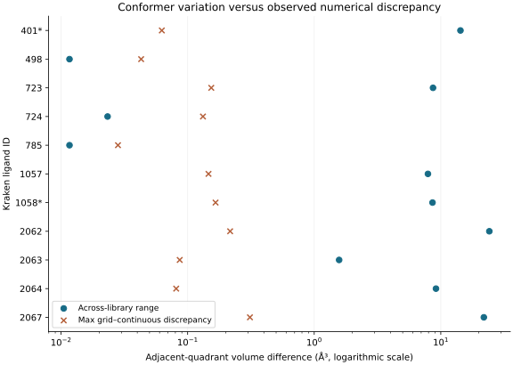

# Conformation, preparation and energy sensitivity

The dataset contains eleven ligand observations and 135 distributed conformers,
with 2–39 records per ligand. Conformers are not independent experimental samples.
Native minimum, maximum, mean, population SD, range and regional distributions are
retained in `results/ensemble_statistics.json` and `results/conformer_descriptors.csv`.
The source's missing per-state energies prevent a justified published-ensemble
Boltzmann calculation.

## Published-library variation

| ID | Records | L range Å | B1 range Å | B5 range Å | %Vbur range, percentage points | Adjacent-quadrant range ų | Max observed grid–continuous difference for that descriptor ų |
|---|---:|---:|---:|---:|---:|---:|---:|
| 401* | 15 | 4.223 | 0.232 | 4.550 | 9.865 | 14.302 | 0.063 |
| 498 | 2 | 0.00029 | 0 | 0.00017 | 0 | 0.0117 | 0.043 |
| 723 | 8 | 0.158 | 0.023 | 1.114 | 8.227 | 8.684 | 0.154 |
| 724 | 2 | 0.00026 | 0.00046 | 0.00001 | 0.017 | 0.0233 | 0.132 |
| 785 | 2 | 0.00030 | 0.00026 | 0.00062 | 0.006 | 0.0117 | 0.028 |
| 1057 | 5 | 0.121 | 0.048 | 0.536 | 8.279 | 7.914 | 0.146 |
| 1058* | 14 | 0.493 | 0.625 | 1.178 | 8.554 | 8.602 | 0.166 |
| 2062 | 23 | 1.597 | 1.759 | 0.927 | 33.448 | 24.186 | 0.217 |
| 2063† | 12 | 0.110 | 0.765 | 0.099 | 0.813 | 1.574 | 0.087 |
| 2064 | 13 | 0.284 | 1.050 | 0.239 | 5.510 | 9.162 | 0.081 |
| 2067 | 39 | 1.399 | 1.146 | 0.281 | 22.798 | 21.890 | 0.311 |

*Source/export P disagreement or mixed configurations; †one opposite indexed axial
sector. These variations cannot all be interpreted as thermal flexibility of a
verified experimental stereoisomer. See [structure audit](DESCRIPTOR_REPRODUCTION.md).

For eight ligands, the adjacent-quadrant range is larger than the maximum observed
finite-grid discrepancy. For 498, 724 and 785, tiny two-record differences are below
that numerical discrepancy and close to source-coordinate precision. Thus it is
incorrect both to ignore conformer choice generally and to call every small change
a chemically meaningful conformational effect. The independent continuous method
makes this distinction observable.

`conformer_sensitivity.py` also samples 1,000 subsets without replacement at sizes
1,2,4,8 and the available full set (capped/deduplicated sizes). It records the
minimum's 5/50/95% quantiles and probability of recovering the full-library minimum.
It uses no experimental outcomes. An ensemble minimum depends on search coverage;
a larger library can produce a more extreme descriptor even without a better model
of accessible chemical states. Full-library recovery is not proof of complete
physical coverage.

## Separate generated-geometry experiments

Two fixed seeds (20261124, 20261125), twenty ETKDGv3 attempts per ligand per seed,
0.25 Å symmetry-aware heavy-atom embedding pruning, and MMFF94 minimization are used.
Optimization permits 2,000 steps, force tolerance 1e-4 and energy tolerance 1e-6.
Post-optimization duplicates within 0.25 Å heavy-atom RMS are excluded with reasons.
All attempted candidates and pre/post coordinates are preserved. Native descriptors
are calculated after four-decimal SDF serialization; MMFF energy is re-evaluated on
that exact serialized geometry, with units kcal/mol and explicit method provenance.
There are no solvent, entropy or measured-population corrections.

The first experiment generated 212 embeddings and retained 121 states. Inspection
found incomplete axial controls because default aromaticity hid the single biaryl
axis of P-containing BINOL rings. Its structures, results and poor models remain in
the evidence bundle. This is a rejected basis for asserting stereo-controlled
populations, not a discarded unfavorable outcome.

The corrected preparation starts from original SDF bond orders, uses MDL aromaticity
and hybridization before embedding, transfers source-encoded R/S labels, and checks
indexed axial/spiro handedness. MMFF still uses its own internal aromaticity model.
It produces **218 embeddings and 69 retained states**. Rejections comprise 59
post-optimization duplicates, eight opposite spiro configurations and 82 opposite
relative axial sectors. No retained optimizer failed its convergence test, and no
retained source-encoded P mismatch was found. This does not verify every absolute
axial configuration or the physical suitability of MMFF for these ligands. In
particular, 401 deliberately follows its source P label instead of the conflicting
published coordinates. The corrected lane is a disclosed post-primary sensitivity.

Published versus generated geometries, two search seeds, and matched retained
pre/post-optimization pairs are summarized separately. Optimization comparisons use
only matching identifiers, avoiding a change of ensemble membership disguised as a
geometry-optimization effect. All eleven features are reported, including small or
zero changes; unsuccessful candidates are never substituted.

## Approximate energy weights and temperature

Native Boltzmann calculations use complete within-ligand MMFF energies, degeneracy
one per retained state, and temperatures 298.15, 353.15 and 400 K. Independent shifted
exponentials reproduce the native weighted means. These are **approximate
force-field weights**, not experimental populations or computed solution free energies.
Absolute energies of different ligand formulas are never compared.

For seed 20261124, within-ensemble energy ranges span 0–8.46 kcal/mol; the effective
number of states at 353.15 K ranges from 1 to 2.84. The largest temperature-induced
change in weighted adjacent-quadrant volume over 298.15–400 K is 1.20 ų (2062).
Several generated ensembles collapse to one state, so their weighted and single-state
values necessarily coincide. Different seeds, optimization and missing conformers
remain more fundamental uncertainties than machine precision.

The generated weighted descriptor's family-held-out RMSE is 1.040 and 1.157 kcal/mol
for the two corrected seeds at 353.15 K, versus 0.389 for the published-library
minimum. Neither approximate weighting nor generic ensemble averaging establishes
a predictive benefit here. This is not an inference that solution populations are
unimportant: the force field, conformer search and stereochemical preparation are
limited proxies. A matched experimentally relevant geometry/energy dataset is needed.

Each seed requested twenty embeddings per ligand (440 requests total). The 218
returned records follow RDKit's combined embedding/pruning process; missing requested
slots are not falsely classified as optimization failures. Per-attempt failed-distance-
geometry counts were not separately exposed by this run, which limits search diagnostics.
