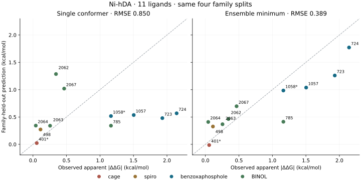

# Experimental statistical results

The fixed comparison favors the published-library minimum in its point estimate,
but **does not establish the primary hypothesis**. There are eleven experimental
ligands in four chemical families, source stereochemistry problems, no verified
published per-state energies, and substantial uncertainty. Outcomes were already
known historically; this is an outcome-aware retrospective analysis with a protocol
locked before these new predictions, not a prospective preregistered discovery.

## Response and validation design

Response is apparent |ΔΔG|=RT ln[(100+ee)/(100−ee)], in kcal/mol, at the reported
353.15 K, R=0.0019872042586408316 kcal mol⁻¹ K⁻¹. It represents a competing-pathway
kinetic interpretation of ee; it is not a measured activation barrier, proof of
irreversibility, or a prediction of product-enantiomer sign. Integer ee and original
author ΔΔG are both retained. The source's 2064 ee/ΔΔG inconsistency is not silently
repaired by choosing the more favorable endpoint. The later corrected SI has the
same Table S3.

Primary outer splits leave out one family: cage (401), spiro (498), benzoxaphosphole
(723,724,1057,1058), or BINOL phosphoramidite (785,2062,2063,2064,2067). All models
use identical outer memberships. Every ligand is predicted exactly once; no
conformer is an experimental row. Model fitting excludes its outer test responses.
Nested ridge scaling and alpha selection use only inner training folds. All fold
predictions, coefficients, ranks, condition numbers, hyperparameters and failures
are retained. No primary or secondary fold failed.

The primary B/C descriptor was selected from the previously published scientific
model. That historical choice was informed by these same outcomes; it affects B/C
as well as the published reference D. Locking it now prevents additional adaptive
selection but cannot create an untouched external test dataset. Reported scores
are retrospective cross-validation, with this selection limitation. Current model
fitting/tuning does not leak held-out responses.

## Primary as-distributed library comparison

B is the maximum adjacent-quadrant occupied-volume difference from the lowest
numeric conformer ID; C is its minimum across the available conformers. Both are
one-slope OLS models with intercept, identical descriptor conventions and equal
capacity. A uses published P NBO charge; D uses the published Kraken steric minimum;
E uses D plus C. Conditions are constant and cannot be fitted as independent controls.

| Model | Predictors | MAE kcal/mol | RMSE kcal/mol | R² | Bias kcal/mol | SD of family-fold RMSE |
|---|---:|---:|---:|---:|---:|---:|
| A0: training mean | 0 | 0.956 | 1.055 | -1.025 | -0.019 | 0.289 |
| A: electronic baseline | 1 | 0.947 | 1.177 | -1.520 | -0.580 | 0.698 |
| B: first conformer | 1 | 0.685 | 0.850 | -0.313 | -0.314 | 0.538 |
| C: ensemble minimum | 1 | 0.323 | 0.389 | 0.724 | -0.133 | 0.176 |
| D: published reference | 1 | 0.311 | 0.378 | 0.740 | -0.128 | 0.167 |
| E: reference + ensemble | 2 | 0.336 | 0.404 | 0.703 | -0.174 | 0.186 |

Pooled ΔRMSE(C−B) = **-0.460 kcal/mol**. A 10,000-draw
paired family-cluster bootstrap gives the descriptive 95% interval
**[-0.728, 0.044]**.
The exact family-loss sign-flip one-sided p is **0.25**
(only sixteen sign patterns). The interval includes no benefit; four clusters
cannot support a strong population inference. Bootstrap resampling conditions on
the saved cross-fitted predictions, does not refit models, and inherits dependence
between overlapping training folds. Ligand-bootstrap intervals are also saved but
do not resolve family dependence. Fold SD is descriptive variability, not an SE.

Asterisks mark the two ligands with source/export P-configuration disagreements.

The combined model does not improve on D. Near-redundancy of two steric predictors,
small training samples and extrapolation limit coefficient interpretation. Coefficients
and simple correlations describe association, not independent causal contributions.

## Correlation and uncertainty

| Predictor | Pearson r | Spearman ρ |
|---|---:|---:|
| A: electronic baseline | -0.650 | -0.533 |
| B: first conformer | 0.775 | 0.806 |
| C: ensemble minimum | 0.915 | 0.907 |
| D: published reference | 0.918 | 0.907 |

These use all eleven observations and are descriptive, with no multiplicity-adjusted
confirmation. The full eleven-feature correlation table, including constant features,
is retained. No feature was selected by these new correlations.

Conditional OLS t prediction intervals assume a fixed linear model with independent,
homoscedastic Gaussian errors. Held-out coverage is 8/11 for A0/A, 10/11 for B/C/D,
and 11/11 for E. Mean interval widths are respectively 3.672, 4.529, 2.838, 3.008,
2.968 and 3.723 kcal/mol. These wide, model-conditional intervals are not guaranteed
new-family prediction coverage; measurement error, model selection and chemical
domain shift are not included. Experimental ee repeatability was not available.

## Sensitivities and unsuccessful models

| Analysis | N | B RMSE | C RMSE | Interpretation |
|---|---:|---:|---:|---|
| Leave one ligand out | 11 | 0.555 | 0.363 | Easier interpolation; not a new independent dataset |
| Exclude P-discrepant 401/1058 | 9 | 0.982 | 0.484 | Three families; bootstrap ΔRMSE interval still crosses zero |
| Filter 1058, exclude 401 | 10 | 0.962 | 0.465 | P-compatible subset; published D still reflects its original construction |
| Also exclude axial-mixed 2063 | 8 | 1.054 | 0.569 | Conservative post-primary identity sensitivity |
| Filter P/relative-axis records, exclude 401 | 10 | 0.962 | 0.465 | Relative geometry control, not verified absolute atropisomer identities |
| Certified continuous regional midpoint | 11 | 0.850 | 0.395 | Same split/structures, explicit numerical method change |

Author ΔΔG and exclusion of 2064 are fully scored in the JSON. Neither changes the
qualitative conclusion. The certified all-lower/all-upper descriptor endpoint fits
are sensitivity scenarios, **not** certified extrema of a fitted statistical model.
The primary improvement is far larger than this numerical-method effect, while
statistical and structural uncertainty remain much larger still.

Nested ridge (inner leave-one-family-out, training-only scaling, alpha in
0.01/0.1/1/10/100/1000) gives RMSE **1.039** for eleven single-state features,
**1.053** for eleven ensemble means, and **1.093** for 33 minimum/maximum/mean
features. Ensemble averaging and more ensemble features do not improve this test.
Fixed random forests/gradient boosting were pre-permitted to be omitted if sample
size could not support their complexity; four clusters and training sets as small
as six do not justify that additional flexible-model comparison. No favorable
nonlinear endpoint is substituted.

Generated-geometry models are separate exploratory preparation experiments. The
corrected MMFF-weighted descriptor gives 353.15-K RMSE **1.040/1.157** across two
seeds; generated minima give **1.214/1.047**. The first, inadequately stereo-controlled
preparation and all its models are preserved too. Neither source is silently mixed
with the published conformers or presented as measured solution populations.

## Scientific conclusion

One particular ensemble minimum has a promising retrospective association and lower
cross-validated error than an arbitrary documented single conformer. The uncertainty
interval includes no improvement; multivariate ensemble means and generated energy
weights do not reproduce the apparent benefit. Native sterics add no demonstrated
predictive information beyond the published steric reference in this small sample.
The broad conformer-aware hypothesis therefore remains **insufficiently supported**.
The study establishes experimental association in a defined dataset, not mechanism,
causation, universal catalyst-ranking utility or an independent prospective validation.
