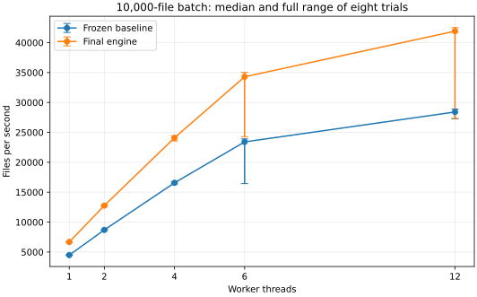

# StericX occupancy and certified continuous volume

**Completed scientific and controlled performance campaign, 2026-11-18.**
The optimized engine preserves all 128,021 historical responses byte for byte.
On the controlled 10,000-file workload, six-thread throughput rises from
23,411.7 to 34,296.4 files/s (1.4649×); the buried-volume kernel is 2.0520×
faster. All twelve originally failing molecular cases now reach a certified
0.05 ų error, and all reach 0.001 ų with the expanded budget.

These are workload-specific results. Small startup-dominated requests can be
slower, retained grid memory increases, and eighteen analytical stress targets
remain unmet. Full distributions, failed attempts and numerical limitations are
preserved. [Final tables](FINAL_TABLES.md), [measurement data](final_measurements.json)
and [accuracy frontier](accuracy_pareto.json) provide the underlying values.

## Scientific accuracy

The historical finite-grid calculation is preserved. Its f32 point lattice,
inclusive squared-distance predicate, operation order, atomic radii, scaling,
hydrogen policy, center/orientation conventions and regional reductions have
not been changed. Three accepted occupancy changes remove scalar tails with
overlapping AVX2 loads, prepare immutable row/Z/regional metadata, and retain
up to eight exact radius/density grid keys per thread under an 8 MiB buffer cap.
Overlapping SIMD results combine by idempotent OR. Short rows and unsupported
platforms retain scalar paths. No occupancy or molecular geometry is cached.

Continuous volume is a different mathematical quantity:

\[
V=\operatorname{vol}\left(B(c,R)\cap\bigcup_i B(c_i,r_i)\right).
\]

The original midpoint-chord estimate and conservative 3D box reference remain
available unchanged. The new explicit Rust API,
`sphere_union_volume_certified`, integrates certified vertical chord lengths
over adaptive XY rectangles. Conservative chord-range bounds apply everywhere.
Where interval predicates prove fixed overlap topology and endpoint ordering,
a tensor midpoint remainder bounded by hemisphere curvature supplies a tighter
enclosure. Analytical contained-sphere and lens cases avoid unnecessary
subdivision. The algorithm splits the rectangle with the largest uncertainty,
inherits conservative atomic candidates and intersects successive global bounds
to preserve nesting. See [the mathematical derivation](CONTINUOUS_MATHEMATICS.md).

`CertifiedVolumeResult` reports volume, lower/upper bounds, absolute and meaningful
relative error bounds, geometric evaluations, subdivisions, cells, runtime,
status and `target_met`. Budget exhaustion and floating-point resolution failure
are explicit. Contradictory bounds return an error. The certificate concerns the
exact supplied binary64 coordinates and radii under IEEE round-to-nearest with
gradual underflow; it does not bound experimental geometry or radius uncertainty.
`BuriedVolumeCalculator::compute_certified_with_center` applies the established
continuous scaling and hydrogen conventions with an explicit center. Certified
regional integrals are not implemented; finite-grid regional output is unchanged.

Two subsequent isolated improvements reduce the cost of this same certificate:
nonnegative interval products select two provably extremal products instead of
four, and per-integration scratch buffers replace repeated temporary allocations.
Signed/nonfinite intervals retain the general arithmetic fallback. Every bound,
work counter and stopping decision in the 695-case certificate replay is exactly
preserved. Scratch data never survives an integration or backs retained heap cells.

### Independent validation and tolerance outcomes

| Evidence | Result and scope |
|---|---|
| Original analytical enclosure suite | 167 observations, zero invalid enclosures; 18 stress targets remain unmet |
| Additional sphere-chain references | 96 analytical observations including rotations/permutations; rational arithmetic and integer square roots; pairwise inclusion–exclusion used only after proving a triangle-free overlap graph |
| Higher-order overlap references | 108 translated/coaxial cases, exact piecewise polynomial cross-section integration times a rational enclosure of pi; all contain the reference and reach 0.01 ų |
| Independent geometric predicates | 6,000 exact-rational rectangle/sphere cases, including extreme exponents and tangencies; zero failures |
| Positive-interval optimization | 100,000 deterministic bit-equivalence cases, including signed zero, overflow, underflow and fallback intervals |
| Original twelve molecular cases | All reach 0.1, 0.05 and 0.01 ų; all reach 0.001 ų at the declared expanded budget |
| Broader molecular set | 220 cases across 56 real conformers, multiple radii/centers, hydrogen and radius-scaling policies; 212 reach 0.05 at 1,048,575 cells; eight R=5 cases fail that cap and succeed at the expanded 4,194,303-cell cap |
| Budget ladders | Nested certified intervals checked; no monotonicity claim for point estimates |

The old box method missed all twelve 0.05 ų targets at 262,143 boxes, with
reported error bounds 1.176–3.065 ų. The new method reaches those same targets
using 30,609–141,719 XY cells, within the original numerical count cap. Cells and
boxes have different costs; their counts are not a runtime ratio. The original
twelve 0.01 cases use at most 504,455 cells; 0.001 uses 780,709–3,193,705.
The eight expanded R=5 cases require 1,079,129–1,332,145 cells. Acceptance
tolerances were never relaxed. Original failed attempts remain in the evidence.

Independent old 3D enclosures overlap all 220 broad molecular results. Eight
preselected rational octree checks also overlap. These are useful independent
consistency checks, not exact molecular truth values. The fine 0.001 molecular
reference used in accuracy plots comes from the same certified algorithm and is
labeled accordingly. Analytical references use independent equations.

The range-only chord ablation still misses all twelve 0.05 targets at 262,143
cells (errors 0.215–0.627 ų). Smooth-region curvature bounds, rather than merely
changing dimensionality, are essential. All-atoms traversal preserves bounds but
requires 1.16–3.98 times as many geometric queries. The old reference's boundary
boxes cannot resolve partial volume tightly enough within its budget.

## Performance

Production baseline: `ffc698f479cc5b0d75ae4f6856edc81ad5ca9c2a`.
Final production implementation: `aeb3ca747ffbefa5003854e5709f2efa0ba0905e`.
Frozen per-file/binary hashes are in the baseline and `final_profile_v2` receipts.
Both binaries use Rust 1.97.0 / LLVM 22.1.6, portable release settings, thin LTO,
one codegen unit and the same locked dependencies. No unsafe fast-math or FMA
contraction was introduced. Hardware is an AMD Ryzen 5 5600G, six physical cores
and twelve logical CPUs. Final A/B trials ran together on Linux 7.0.0-43; initial
profiling ran on the earlier kernel recorded in the baseline manifest. The reboot
and unchanged compiler/hardware are recorded in `resumed_environment.json`.

Historical six-thread throughput of 23,783.8 files/s is context only. This campaign
uses the freshly measured 23,411.7 files/s denominator. All main paired timings
retain eight alternating trials per side and declared warmups. Statistics are
medians, unscaled MAD and full ranges, not confidence intervals. Fresh-process
measurements use warmed OS file caches; they do not measure cold-disk startup.

| Threads | Fresh baseline files/s | Final files/s | Speedup | Final efficiency |
|---|---|---|---|---|
| 1 | 4,490.1 | 6,680.4 | 1.4878× | 100.00% |
| 2 | 8,701.9 | 12,766.3 | 1.4671× | 95.55% |
| 4 | 16,566.2 | 24,088.5 | 1.4541× | 90.15% |
| 6 | 23,411.7 | 34,296.4 | 1.4649× | 85.56% |
| 12 | 28,413.9 | 41,926.5 | 1.4756× | 52.30% |

| Kernel/workflow | Baseline µs | Final µs | Speedup |
|---|---|---|---|
| volume | 166.737 | 81.258 | 2.0520× |
| regions | 166.277 | 81.135 | 2.0494× |
| ensemble | 1124.660 | 681.855 | 1.6494× |
| radius_profile | 758.524 | 327.317 | 2.3174× |
| sterimol | 12.472 | 12.498 | 0.9980× |

The unchanged Sterimol control is 0.9980×, slightly slower. A single small
one-thread CLI request is also slower (1.563 to 1.647 ms, 0.9489×). Parsing-only
work stays essentially flat. The 56-conformer CLI workload improves 1.3956× at
one thread and 1.2037× at six; twelve threads have more overhead on that small
batch than six. Twelve threads do improve the 10,000-file throughput, but parallel
efficiency falls to 52.30%. No nested occupancy pool was introduced.

Quiet endpoints do not guarantee an interruption-free interval. All slow trials
remain, including a final six-thread 10,000-file range of 285.510–411.721 ms
(median 291.576 ms, MAD 4.185 ms), and a 65.525 ms four-thread ensemble-SDF
trial. No outlier removal or post-hoc threshold relaxation was used.

### Memory, allocation and CPU cost

For the 10,000-file workload, median peak RSS at six threads is 25.076 MiB
baseline versus 25.766 MiB final; at twelve, 26.395 versus 27.572 MiB. Median
user-plus-system CPU time falls from 2.344 to 1.579 seconds at six threads.
Complete CPU/wall/RSS/fault/context-switch distributions are in the final tables'
linked data. Allocation instrumentation is separate from native timing.

Default prepared-grid buffer retention grows from 393,216 to 495,808 bytes
(26.09%). The multi-key cache retains at most 8 MiB per thread plus fixed
bookkeeping; this is not a process memory limit. Warm volume calls retain three
allocation calls and nine reallocations; the gain comes from less occupancy
work. Warm radius-profile allocation calls fall from 68 to 62 and requested
allocation bytes from 1,440,751 to 12,355 per workflow, while process peak live
bytes increase from 1,323,968 to 1,843,672 because grids remain cached.

For continuous integration, scratch reuse reduces median allocation calls by
82.80% at 0.05 and 83.85% at 0.01 across the original twelve molecules. Maximum
live bytes at 0.01 change slightly from 29,371,032 to 29,372,128: the adaptive
heap dominates. The combined interval/scratch optimizations deliver a controlled
median 1.1869× speedup over the initial certified API across 24 molecule/tolerance
cases (per-case ratios 1.1291–1.2218×), preserving every bound and work count.

### Accuracy-adjusted runtime

Eighteen inputs (the original twelve molecules and six independent analytical
coaxial cases) were measured in eight passes: 1,152 observations, 144 configurations.
Every certified 0.1/0.05/0.01 target succeeds. For the original twelve:

| Certified target ų | Achieved | Median of per-molecule medians, ms | Range of per-molecule medians, ms |
|---|---|---|---|
| 0.1 | 12/12 | 13.092 | 6.042–40.309 |
| 0.05 | 12/12 | 23.459 | 11.152–72.662 |
| 0.01 | 12/12 | 92.776 | 46.410–289.953 |

At 262,143 boxes, the old enclosure takes 42.65–139.05 ms and reports error
bounds 1.176–3.065 ų. At 1,048,575 boxes it takes 181.92–561.03 ms and still
reports 0.588–1.536 ų, missing even 0.1 on these molecules. Thus an equal-target
speedup ratio against that method is undefined; reporting its apparently close
point estimate as a certificate would be incorrect.

Midpoint 128 takes 0.099–0.524 ms. Its observed molecular error upper bounds
against the separate 0.001 enclosure range from 0.00103 to 0.01115 ų, but it
has **no intrinsic error certificate**. Finer midpoint results are not uniformly
closer. Molecular observed-error references come from the same certified method;
only the six coaxial accuracy references use independent exact equations.

[The per-input Pareto frontier](accuracy_cost_pareto.svg) and
[fastest-by-target records](accuracy_pareto.json) keep these classes separate.
The adaptive chord method is the fastest tested certified method at every
0.1/0.05/0.01 target on all eighteen inputs. Under the separately labeled
observed-error class, midpoint 128 is fastest at 0.1/0.05 and on seventeen of
eighteen 0.01 cases; midpoint 256 wins the remaining observed 0.01 case. This
is not a certified superiority claim or a universal optimum.

### Parallel certified batches

A final supplement measures the same twelve molecular 0.05 ų certificates
with explicit caller-owned Rayon pools. All 45 processes preserve every bound,
work count and result order. The serial integration API itself is unchanged.
Pool creation, parsing and one warmup are outside the internal batch timer;
whole-process CPU/RSS metrics include them.

| Workers | Twelve-molecule batch, ms | Speedup over one | Efficiency | Median process peak RSS, MiB |
|---|---|---|---|---|
| 1 | 333.128 | 1.0000× | 100.00% | 16.127 |
| 2 | 171.186 | 1.9460× | 97.30% | 18.566 |
| 4 | 110.675 | 3.0100× | 75.25% | 34.650 |
| 6 | 83.392 | 3.9947× | 66.58% | 42.682 |
| 12 | 89.091 | 3.7392× | 31.16% | 57.826 |

Six workers are fastest on this twelve-task batch. Twelve are slower and retain
more process memory; no universal worker-count recommendation follows. These
measurements establish batch scaling, not parallel subdivision of one integral.
[Full certified scaling distributions](CERTIFIED_SCALING.md) include MAD, ranges,
CPU time, wall time and peak RSS for all worker counts. No nested production
thread pool or new concurrency default was introduced.

Exploratory and rejected candidates remain in `o1_measurements.json` through
`o5_measurements.json`, `c3_measurements.json`, `c4_measurements.json` and
[EXPERIMENTS.md](EXPERIMENTS.md). X-slab filtering regressed the representative
path by about 12%; general BVH/cell-list/internal-parallel variants failed to
amortize on most real conformers. Large sparse synthetic gains are retained
without generalizing them to molecular workloads.

## Profiling

Fresh baseline occupancy accounts for 115,933,006 of 130,723,468 modeled Callgrind
instructions (88.69%). The prior campaign's 81.55% is a different historical
measurement. Algorithmic counters and full-mask comparisons cover 42 initial and
101 spatial-research configurations, including 56 real conformers and synthetic
sizes through 1,024 atoms. Per-row candidate counts, tail decisions, duplicate
hits and preprocessing/execution costs are retained.

The first accepted-source reprofile reduces total instructions to 78,307,346
(40.10% fewer) and exclusive occupancy to 62,986,231 (45.67% fewer). Occupancy
remains 80.43% of modeled instructions. The final-v2 reprofile records 78,320,019 total instructions and the identical
62,986,231 exclusive occupancy instructions. [Before](baseline_flamegraph.svg) and [after](final_v2_flamegraph.svg)
flamegraphs show instruction counts, not CPU time. Assembly inspection finds no
FMA in the occupancy kernels. Static SIMD opcode counts cannot establish dynamic
hardware SIMD utilization.

Cachegrind's L1 data misses and branch counts fall, but its last-level data misses
increase and its branch misprediction fraction rises. These unfavorable findings
are preserved in [the profile](OCCUPANCY_PROFILE.md). `perf stat` is denied at
`perf_event_paranoid=4`. Native cycles, IPC, branch/cache events and memory
bandwidth are unavailable. The evidence identifies repeated candidate/predicate
and mask work; it does not prove a hardware arithmetic-port or bandwidth limit.

Continuous profiling identified interval arithmetic, chord evaluation and
allocation as substantial modeled costs. Arithmetic specialization precedes
scratch reuse in separate commits and paired experiments. Future work should
target singular/tangent boundary regions and proven topology changes; extremely
tight targets can still exhaust the cell budget or floating-point resolution.

## Competitive results

The 56-conformer gate validates 2,588,544 independent exact-decimal/IEEE point
decisions; the separate twelve-conformer, three-radius gate validates 1,664,064.
Ordered-output preflights cover 1/2/4/6/12 workers. Identical point masks and
scientific conventions are checked before timing. Native f32 and Python f64
reductions have small expected rounding differences: each is checked against
its independently specified reduction, not asserted to have identical float bits.

StericX uses its public Rust API, Morfeus its public buried-volume/octant APIs,
and DBSTEP's occupied-point kernel receives the admitted common grid. **The
DBSTEP column is an explicit adapter, not DBSTEP's default-grid workflow.**
The base policy uses R=3.5 Å, density 0.01, scale 1.17, excluded hydrogens and
the declared center distance 2.28 Å. The radius policy fixes R=2.5/3.5/4.5 Å and
`density=0.01*(R/3.5)^3`, preserving a 32-side lattice; it is distinct from a
constant-density profile. Versions are Morfeus 0.8.0, DBSTEP 2.2.0, NumPy 2.5.4,
SciPy 1.18.1 and Python 3.12.13. BLAS/OpenMP threads are restricted to one.

Selected warmed-workflow results (median ms; eight trials, all retained):

| Workload | StericX ms | Morfeus ms | DBSTEP adapter ms | Morfeus/native ratio | DBSTEP/native ratio |
|---|---|---|---|---|---|
| 56 conformers / 1 worker | 7.492 | 751.380 | 633.198 | 100.29× | 84.51× |
| 56 conformers / 6 workers | 1.600 | 172.028 | 152.926 | 107.49× | 95.55× |
| 1,000 calculations / 6 workers | 23.634 | 2776.245 | 2598.379 | 117.47× | 109.94× |
| 12 conformers × 3 radii / 6 workers | 0.955 | 103.835 | 97.836 | 108.76× | 102.47× |

There are 432 base-workflow and 162 radius-workflow trials including warmups.
The 1,000-calculation batch repeats the 56 geometries; it is not 1,000 unique
molecules. Full fresh-process/warm distributions and all thread counts are in
[FINAL_TABLES.md](FINAL_TABLES.md). Startup is material: the one-input fresh
process medians are 1.238 ms native, 286.337 ms Morfeus and 284.898 ms DBSTEP
adapter. Those ratios are not occupancy-kernel speedups.

Separate 1,000-calculation process-tree memory sampling gives approximate
six-worker summed-RSS peaks of 7.00 MiB native, 555.29 MiB Morfeus and
554.52 MiB DBSTEP adapter. Summed RSS double-counts shared pages, sampling can
miss peaks, and wait4 max RSS is not whole-tree memory. These diagnostics were
collected separately from timing and cannot support a precise memory-efficiency
ratio. All fifteen memory configurations are retained in `competitive_memory_v2`.

These speed ratios are supported only for the admitted finite-grid workflows.
Matched grids do not establish equal continuous accuracy. No equivalent certified
continuous API was admitted for the external tools, so no continuous speed
superiority or universal tool ranking is claimed.

## Regression and reproducibility

All 128,021 historical outputs in thirteen lanes are exactly preserved on both
the first accepted-source replay and the fresh final-v2 replay. Full independent Morfeus/DBSTEP/Kraken reference,
regional-bin, model and thermodynamic replays preserve their scientific results,
including known historical disagreements. The final-v2 transition changes only
the separate certified implementation; fresh exact-output and engineering
receipts bind that transition. [Final scientific admission](final_admission.json)
records the completed gates and their hashes. This does not relabel historical discrepancies as
new passes or claim that every external reference program ran twice.

The final native and Rust 1.85 suites each pass 372 tests. Python bindings pass
71 tests and research checks pass 156 without skips. macOS/Windows target checks
pass, and QEMU AArch64 passes 369 applicable tests (three x86-specific tests are
not compiled on ARM). Emulated/compile-only checks are not physical-platform benchmarks.
The upstream DBSTEP suite retains 413 passes and three skips. The optimized
certificate replay preserves all 695 scientific responses exactly, excluding
runtime and allocator diagnostics only.

Accepted commits: `29bc3313` (AVX2 tails), `34e32d33` (prepared grid), `d732d1cb`
(bounded grid LRU), `15534fb8` (certified chords), `2ae0b3fb` (positive intervals),
`aeb3ca74` (scratch reuse). Freeze and validation evidence have separate commits.
No releases or publications were made.

[Reproduction commands](REPRODUCIBILITY.md), [baseline](BASELINE.md),
[candidate ledger](CANDIDATES.md), [failed experiments](EXPERIMENTS.md) and
[work log](WORK_LOG.md) identify the retained controllers and receipts. Raw
measurements, source archives, binary hashes and frozen datasets are under
`.stericx/occupancy_precision/`. A bare Git clone does not include those large
local historical datasets. Input hashes, compiler/hardware details and workload
identities are tracked in `baseline_manifest.json` and `workload_identity.json`.
No historical evidence or failed experiment was removed.

## Timing admission and remaining limitations

The original quiet-host failures and all repeated attempts remain in
[timing_admission.json](timing_admission.json). After explicit user authorization,
only Warp's GUI process was temporarily suspended with an independent automatic
restore watchdog. Its process identity and successful SIGCONT restoration are
recorded; Warp was verified running normally after the last stage.

Window 2 completed 630 CLI trials but failed its final parent I/O-wait gate
(0.0819 cores > 0.05), so it is retained as inadmissible timing evidence. Window 3
admits CLI A/B, kernel A/B, certified A/B and kernel diagnostics; its next-stage
preflight failed before CLI diagnostics began. Window 4 admits CLI diagnostics,
accuracy, competitive and radius-competitive stages. A separate fixed-accuracy
certified-batch supplement then passes both quiet endpoints and all 45 process
checks. The first qualifying result
for each stage is used. Every admitted parent/child endpoint satisfies the
unchanged <=0.15 busy-core / <=0.05 I/O-wait-core gates. No slow sample was dropped.

Hardware counters remain inaccessible on the resumed kernel; no measured cycles,
IPC or bandwidth claim is possible. Physical ARM/macOS/Windows timing, universal
spatial-acceleration wins, certified regional continuous integrals and a universally
best integration algorithm remain outside the demonstrated results. The eighteen
analytical stress failures and the eight broad molecular failures at the original
expanded cap remain documented even though larger budgets solve the latter.

[Completion audit](COMPLETION_AUDIT.md) maps the requested phases to authoritative
receipts, including known limitations. Final measurements and scientific reports
are complete; no package or release was published.
