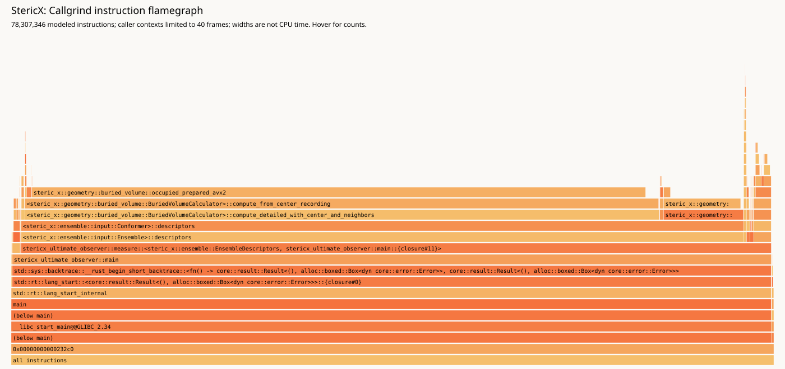

# Occupancy profile before optimization

Baseline source: `ffc698f4`; fresh builds and input identities are in
`baseline_manifest.json` and `.stericx/occupancy_precision/baseline/build.json`.
Native timing/scaling tables remain pending; instruction and simulator results
below are fresh measurements, with a final-source supplement at the end.

## Instruction and assembly findings

The public six-conformer observer performs one warmup, five iterations and one
output evaluation. Callgrind records **130,723,468 modeled instructions**, of
which **115,933,006 (88.69%)** are exclusive to AVX2 occupancy. Widths in the
[before flamegraph](baseline_flamegraph.svg) are instructions, not elapsed time.
Inline instructions stay attributed to their containing function. The sum of
self costs reconstructs the Callgrind total exactly.

Fresh Cachegrind records 130,748,513 instructions, 27,225,275 data references,
409,087 L1 data misses, 9,628 last-level data misses, and 927,617 branch
mispredictions in its configured simulation. These are **not hardware events**.
Its split 32 KiB/8-way L1 and 16 MiB/16-way last-level model omits actual L2,
speculative execution and hardware prefetch behavior. See
[event data](baseline_profile_events.json) and the
[Cachegrind documentation](https://valgrind.org/docs/manual/cg-manual.html).

The actual `perf stat` attempt was denied at `perf_event_paranoid=4`; cycles,
IPC, real branch/cache behavior and memory bandwidth are unavailable. No CPU
throughput or bandwidth ceiling is inferred from the simulator.

The disassembled occupancy function contains separate packed multiply/add,
ordered comparisons and POPCNT, with no FMA. It also contains permutations,
blends and variable shifts for gathering Z values and constructing positive-Z
masks. Static opcode counts are not dynamic SIMD utilization.

Callgrind's source attribution identifies 19.30 million instructions on XY
distance/filter source lines, 4.63 million on Z gathering/positive masks,
2.03 million on row detection, and 15.65 million on scalar-tail loop/distance/
mask lines. Optimized debug-line attribution is approximate: instruction motion
and intrinsic/inlined library attribution prevent treating these as disjoint
complete subroutine timing measurements. Raw assembly, annotated source and
profiler output remain under `.stericx/occupancy_precision/baseline_*`.

## Algorithmic counters

An isolated observer appends instrumentation to an exact source copy. A separate
replay of the AVX2 algorithm counts XY atom tests, retained candidates, full
eight-point vectors, scalar tail decisions, repeated covered hits, row lengths
and occupied points. It compares every vector mask against scalar operations
and every union bit against the independent original direct-distance loop.
All **42 configurations** (36 molecular orientations and six synthetic sizes
1–1,024 atoms) have zero mask mismatches. Counts are in
[baseline_counters.json](baseline_counters.json). Zero-iteration counter runs
have no timing interpretation.

The default grid has 15,408 points in 740 XY rows. Triphenylphosphine's first
frame executes 14,060 XY tests, retains 2,765 candidates and performs 59,660 Z
decisions, including 9,148 scalar-tail decisions. Its 4,517 occupied points
receive 5,224 redundant hits from overlapping atoms. For methylphosphine the
corresponding counts are 1,480 XY tests, 518 candidates, 13,452 Z decisions and
1,948 scalar-tail decisions. Preprocessing must therefore remain inexpensive
for small molecules.

## Ranked experiments

1. Remove scalar tails for rows of at least eight points using a final overlapping
   vector load. This preserves each predicate and can replace expensive scalar
   mask assembly with one vector operation sequence.
2. Reuse exact squared-X prefixes and filter candidates per X slab before XY
   rows. The implication uses nonnegative squared terms and preserves original
   f32 grouping; no approximate geometric cutoff is acceptable.
3. Cache immutable row/Z/region metadata along with the grid. Measure preparation,
   retained bytes and cold overhead separately. Geometry-specific occupancy
   cannot be cached under a grid-only key.
4. Compare interval/bitset unions and larger spatial structures for dense grids
   and large molecules. The previous 15.6%-slower endpoint-search experiment is
   retained historical evidence, not a predicted gain.
5. Evaluate internal parallelism only where a large individual integration
   amortizes scheduling. Batch parallelism already exists; nested pools must
   not be introduced implicitly.

Current evidence establishes substantial repeated predicate and mask work. It
does not establish whether hardware arithmetic ports, branch speculation or
memory bandwidth are the limiting microarchitectural resource. Candidate
timings and re-profiling will test the actionable hypotheses.

## Reprofile after accepted changes

The same six-conformer observer workload has 78,307,346 modeled Callgrind
instructions versus 130,723,468 before optimization (40.10% fewer). Exclusive
occupancy falls from 115,933,006 to 62,986,231 (45.67% fewer), but remains 80.43%
of modeled instructions. Sterimol projection is next at 7,213,668; descriptor
orchestration is 1,349,442. These are exclusive modeled instruction counts,
not native CPU cycles or wall-clock shares.

The prepared AVX2 assembly has no FMA. Its contiguous Z loads replace repeated
point-field gathering; overlapping final vectors replace scalar tails. SIMD
lane duplication is deliberate and is not described as higher hardware SIMD
utilization. Register/instruction inspection and explicit algorithmic counters
are the available evidence; measured IPC and bandwidth remain unavailable.

Cachegrind reports 18,652,903 data references versus 27,225,275; simulated L1
data misses fall from 409,087 to 227,982. Simulated last-level **data** misses
increase from 9,628 to 11,076, consistent with the larger retained metadata
working set but not proof of native cache behavior. Simulated branch counts
fall from 17,304,369 to 8,503,314 and mispredictions from 927,617 to 672,573;
the misprediction *fraction* rises. Unfavorable results are retained.

The dominant remaining work is still repeated atom/row arithmetic and SIMD
mask generation. Spatial filtering reduces candidate counts in research
variants, but its setup cost regresses most tested real conformers. Thread
scheduling and memory bandwidth cannot be ranked from these simulated events;
controlled thread-scaling and native timing are separate final measurements.

`final_profile_events.json` binds the full assembly, exclusive costs and
simulation files. Raw Callgrind, Cachegrind, DHAT and Memcheck outputs are in
`.stericx/occupancy_precision/final_valgrind/`. The default prepared grid retains
495,808 buffer bytes versus 393,216 point-buffer bytes previously (26.09% more).
Multiple retained keys can use up to 8 MiB per thread, plus fixed cache/Rc
bookkeeping; this cap is not a whole-process memory bound.

## Final production source reprofile

The final-v2 binary records 78,320,019 modeled instructions. Occupancy's exclusive
62,986,231 is identical to final-v1; small process/runtime instruction differences
remain recorded rather than forcing total equality. Final Cachegrind events are
78,334,599 instructions, 18,652,911 data references, 227,660 L1 data misses,
11,071 last-level data misses, 8,503,332 branches and 673,032 mispredictions.
There is still no occupancy FMA. The exact final source and assembly are bound in
[final_diagnostics.json](final_diagnostics.json), and its full context figure is
[final_v2_flamegraph.svg](final_v2_flamegraph.svg). Prior final-v1 evidence remains.

For one asymmetric-phosphine 0.05 ų integration, modeled instructions fall from
812,610,878 before C3/C4 to 646,710,617 after them (20.42% fewer). The final
[continuous flamegraph](continuous_final_flamegraph.svg) still attributes most
instructions to cell bounds, chord predicates and adaptive traversal. Inlining
moves specialized arithmetic into chord_cell; increased function-local counts
must not be mistaken for an overall regression. Allocation calls fall by median
82.80% at 0.05 and 83.85% at 0.01 on the original twelve molecules. Maximum live
bytes at 0.01 rise slightly from 29,371,032 to 29,372,128: retained scratch does
not reduce the dominant adaptive heap. These diagnostics imply no native speed
ratio. Full allocator rows, including unfavourable changes, are retained.
