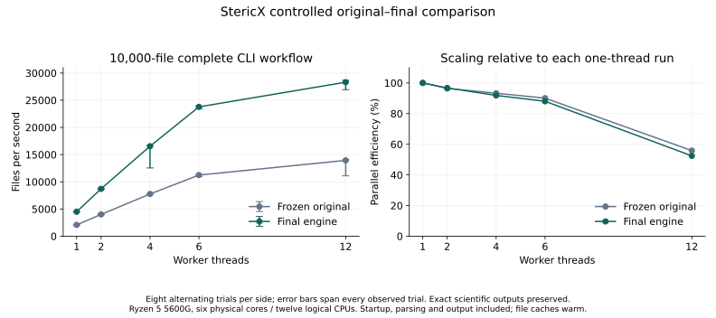
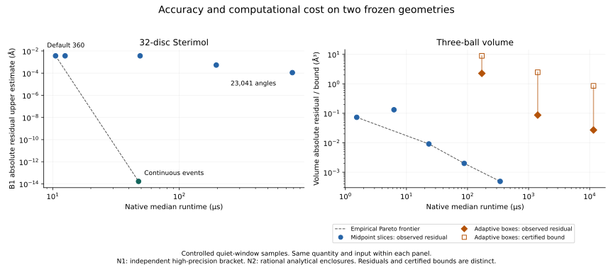

# StericX final scientific and engineering report

Completed 2026-11-17 for the available Linux x86-64 host, with hardware and
scientific limitations explicitly recorded below. All applicable campaign
phases, final controlled measurements and reporting are complete. Unavailable
hardware counters and physical cross-platform tests remain unavailable, not
implicitly passed. Historical failures and unmet numerical targets remain
preserved. No release or package was published.

The final engine processes the frozen 10,000-file workload at **23,783.8 files/s
with six threads**, versus **11,242.0 files/s** for the original implementation:
**2.1156× throughput, +111.56%, or 52.73% less elapsed time**. All 630 CLI A/B
trials preserve their exact scientific outputs and ordering. The numerical
improvements are explicit Rust APIs; existing descriptor defaults are unchanged.

## Scientific accuracy

Original implementation: `c03630cb3595eb85b5d05bdbecd3f10305b818bf`.
Final production implementation: `f9c952e2`; subsequent commits contain campaign
controllers, evidence and reports. The complete scientific audit covers Sterimol,
hard-sphere total/regional volumes, radius profiles, conformers, thermodynamics,
electron-density parsing/integration, pyramidalization, models and input/radius
conventions. See [SCIENTIFIC_AUDIT.md](SCIENTIFIC_AUDIT.md).

All **128,021 historical responses in 13 lanes match exactly**, including
floating-point results, errors and ordering. Independent replay covers 31,721
volume references, 95,163 frames, 1,141,956 regional bins and the fixed 2,517-variant
Kraken union in both inferred- and supplied-topology lanes. This preserves prior
validated behavior without relabelling historical negative conventions as passes.
The DBSTEP extra sphere clip remains a separate failed default-grid comparison;
69 common-node cases/207 frames resolve that specific implementation difference.

Two independently confirmed defects were corrected. An absolute variance
threshold incorrectly suppressed R² for small nonconstant targets; exact dyadic
witnesses now give R² = 0.75 at three scales. Existing syntax also violated the
declared Rust 1.85 minimum; actual minimum-toolchain builds/tests now pass.
The new R² witness was absent from the historical response stream and is tested
separately. No radii or chemical constants were tuned to improve agreement.

| Quantity/method | Original accuracy | Final accuracy and scope |
|---|---|---|
| Default Sterimol and finite-grid volumes | Sampled directions and represented f32 geometry; finite-grid agreement does not certify continuous error | Defaults exactly preserved |
| Explicit continuous Sterimol | No event-based continuous API | f64 support-envelope events, 39 independent 80-digit reference cases; no universal floating-point error certificate |
| Explicit continuous volume | Finite lattice only in this API family | Midpoint chord integration and conservative Reference enclosures; 244 analytical/adversarial observations, including 167 reference results |
| Density integration | Thresholded cell sum, dependent on grid and electronic-structure input | Same scientific result; ordinary-token parsing allocations removed |
| Ensembles and thermodynamics | Defined missing-energy, unit and weighting behavior | Independently replayed; energy provenance and conformer coverage remain physical assumptions |
| R² | Incorrectly missing for sufficiently small nonconstant targets | Scale-consistent correction, constant-target behavior preserved |

New volume reference bounds contain the independent analytical enclosures in
all tested cases. Twenty-three stress/budget targets remain unmet, as do all
12 strict molecular 0.05 ų targets at the tested 262,143-box budget; each is
reported as `target_met=false`. Molecular independent intervals overlap, which
is not knowledge of an exact molecular volume. N1/N2 remain explicit Rust APIs;
CLI/Python defaults are not silently changed. Full mathematics, reference
implementations, convergence and failures are in
[NUMERICAL_ACCURACY.md](NUMERICAL_ACCURACY.md).

## Controlled performance

The final comparison used the same frozen inputs, definitions, portable release
build settings and affinity for both sides. One warmup and eight alternating
A/B pairs were retained per configuration. Seven CLI workloads were measured at
1/2/4/6/12 threads; isolated kernels, Python layers, numerical methods and
external workflows have separate timing scopes. No outlier was discarded.

| Threads | Original files/s | Final files/s | Final elapsed median ± MAD | Final parallel efficiency |
|---|---:|---:|---:|---:|
| 1 | 2,080.3 | 4,503.3 | 2,220.596 ± 5.346 ms | 100.00% |
| 2 | 4,011.0 | 8,711.2 | 1,147.948 ± 5.059 ms | 96.72% |
| 4 | 7,762.2 | 16,545.9 | 604.378 ± 2.176 ms | 91.85% |
| 6 | 11,242.0 | 23,783.8 | 420.455 ± 1.456 ms | 88.02% |
| 12 | 13,941.4 | 28,320.8 | 353.097 ± 1.823 ms | 52.41% |

MAD is the unscaled median absolute deviation, not a confidence interval.
Twelve logical threads share six physical cores. The 15,000/20,000 files/s
aspirations are exceeded on this workload without changing its accuracy. The
older 10,774.5 files/s result is historical context, not the comparison baseline.



| Controlled workload | Original median | Final median | Ratio |
|---|---:|---:|---:|
| Small single-file CLI, one thread | 1.835 ms | 1.613 ms | 1.138× |
| Large single-file CLI, one thread | 1.889 ms | 1.665 ms | 1.134× |
| 56-conformer CLI, one thread | 28.634 ms | 13.939 ms | 2.054× |
| 56-conformer CLI, six threads | 7.034 ms | 4.253 ms | 1.654× |
| SDF ensemble CLI, one thread | 45.531 ms | 24.031 ms | 1.895× |
| Buried-volume kernel | 486.487 µs | 166.608 µs | 2.920× |
| Regional-volume kernel | 486.701 µs | 166.797 µs | 2.918× |
| Six-conformer ensemble kernel | 2,884.573 µs | 1,126.669 µs | 2.560× |
| Radius-profile kernel | 1,650.179 µs | 763.852 µs | 2.160× |
| Default Sterimol control kernel | 12.678 µs | 12.478 µs | 1.016× |

The unchanged default Sterimol control's small difference is not attributed to
a new Sterimol optimization. Parser-only CLI is effectively unchanged (one-thread
median 187.211 → 187.503 ms, a 0.16% regression). JSON decoding and NumPy export
also show small unfavorable differences. Twelve threads are slower than six
for the 56-conformer CLI and the six-conformer in-memory batch. The four-thread
large-batch 796.989 ms trial and 15.162 ms single-file tail remain in the data.
Quiet endpoints do not guarantee an interruption-free machine between checks.

Full timing distributions, CPU time/utilization, context switches, RSS and ranges
are in [final_measurements.json](final_measurements.json), with readable complete
[FINAL_TABLES.md](FINAL_TABLES.md). Hardware: Ryzen 5 5600G, Ubuntu 26.04.1,
Linux 7.0.0-31, Rust 1.97/LLVM 22.1.6. The repository/output disk is a rotational
SATA drive mounted with NTFS3. Fresh-process timing includes startup and imports
where applicable, with warmed OS file caches; no controlled disk-cache-cold or
durable-write performance claim is made.

## Python and competitive workflows

The paired six-conformer bridge improves 3.137 → 1.412 ms and the public typed
API 3.830 → 2.099 ms. Separate final native/bridge/public medians are
1.132/1.414/2.110 ms; their different build profiles mean subtraction is not a
pure PyO3 transition measurement. JSON decode is 405.6 µs, typed construction
156.5 µs, NumPy export 53.2 µs and options encoding 5.77 µs. These isolated costs
are not additive guarantees. A 56-file public batch takes 19.823 ms with one
thread and 10.167 ms with six; per-file calls take 20.511 ms on one thread.

The competitive volume comparison admits 2,588,544 independently certified
point decisions on 56 conformers/168 frames. All 432 timing launches reproduce
the expected per-tool results. For the warm 56-conformer workflow at six workers,
StericX takes 2.143 ms, Morfeus 166.786 ms and the explicitly matched DBSTEP
workflow 155.516 ms. DBSTEP here uses its unchanged occupied kernel on the
common grid with declared regional reductions, **not its default grid workflow**.
These are matched-workflow observations, not whole-library superiority claims.

A prospectively fixed 0.01 Å Sterimol gate on all twelve selected molecules
passes native 361-direction and continuous methods. Morfeus 361 directions
misses one B1 target (0.012548 Å); DBSTEP's classic 361-direction method misses
another (0.015544 Å). Their costs and every failed case remain reported, but
no equal-accuracy cross-tool speed ratio is admitted for this task. The native
continuous method is more accurate and more expensive than native 361 sampling
on this molecular batch (167.353 versus 121.073 µs). See
[COMPETITIVE_BENCHMARKS.md](COMPETITIVE_BENCHMARKS.md) for versions, adapters,
startup/warm distributions, worker scaling and separate sampled memory.

## Accuracy-adjusted cost

Final controlled costs cover all 39 Sterimol cases/234 configurations and 11
volume geometries/72 configurations. On the 32-disc support witness, the default
scan costs 10.536 µs with 0.003656 Å residual; continuous events cost 47.664 µs
with an estimated upper residual of 1.69e-14 Å. A 23,041-angle scan costs
782.094 µs with 0.0001113 Å residual. Continuous events therefore offer lower
error and cost than that dense scan on this input; the default remains cheaper
at lower accuracy.

For the three-ball volume chain, midpoint 256 costs 342.608 µs with 0.0004896 ų
residual, while the 65,535-box reference costs 11.564 ms with 0.027056 ų residual
and a conservative 0.853063 ų bound. Certification is a different requirement
from a small observed residual. The more expensive reference method is retained
for its explicit bound, not advertised as the fastest general volume method.



[All per-input Pareto data](final_accuracy_pareto.json) retain absolute/relative
error estimates, runtime and available certified bounds. Curves are empirical,
not universal optimality or monotone convergence claims. Earlier 244-case
validation and all unsuccessful targets remain authoritative alongside this
controlled cost subset.

## Profiling, memory and remaining costs

Profiling preceded optimization. Original single-thread exclusive hotspots were
occupancy (81.85%) and grid construction (9.08%). The final 10,000-file diagnostic
has occupancy 81.55%, Sterimol support 6.41%, XYZ parsing 5.11%, file parsing/I/O
3.08% and neighbor detection 0.78%; occupancy remains dominant despite a large
absolute reduction. Grid construction runs once (39.5 µs). Its instrumented
2.238 s interval is 0.75% above the contemporaneous native median; this is an
observed overhead estimate, not a fixed profiler correction.

Callgrind modeled instructions fall 297,765,939 → 130,723,530 (56.1%).
[Original](baseline_flamegraph.svg) and [final](final_flamegraph.svg) flamegraphs
show modeled instructions, not sampled time. AVX2 separate multiply/add,
ordered comparisons and POPCNT execute in the final occupancy path; no FMA
changes the predicate. Portable fallback and 5,200 adversarial mask cases pass.

The 10,000-file allocation diagnostic requests 4,115,596,082 → 172,600,345 bytes;
allocation calls fall 3,056,774 → 3,016,776. Peak requested heap rises
14,250,613 → 14,643,883 bytes. The separate ensemble DHAT workload requests
17,142,207 → 985,652 bytes (94.25% less), but peak live heap rises
460,176 → 605,663 bytes. Default cached-grid capacity is 393,216 bytes per
participating thread, capped at 8 MiB/thread. Radius-profile peaks also rise.
The tradeoff is lower allocation traffic with retained memory, not universal
peak-memory reduction. Native 10,000-file RSS medians are 21.11 → 21.45 MiB at
one thread and 26.49 → 25.11 MiB at six. Warm allocation modes show no net growth.

Hardware cycles, IPC, actual cache misses and memory bandwidth are unavailable:
perf counters are denied at `perf_event_paranoid=4`. Cachegrind supplies explicitly
modelled events, not a replacement hardware measurement. LLVM remark attempts
produced no useful report; assembly plus dynamic execution and equality checks
support SIMD findings. [PROFILING_REPORT.md](PROFILING_REPORT.md) records all
methods, overhead, unfavorable results and ranked remaining bottlenecks.

## Implementation and accepted commits

| Commit | Change / main Rust files |
|---|---|
| `51131ec7` | Freeze source, baseline outputs and profiling before optimization |
| `ab1465be` | U1: borrowed ordinary tokens in `src/density/mod.rs` |
| `a286124b` | S1: R² correction in `src/model/fit.rs`, `src/model/evaluation.rs` |
| `e04bc0cf` | U2: exact-bit-key bounded per-thread integration-grid reuse in `src/geometry/buried_volume.rs` |
| `f3658d36` | U3: AVX2 row occupancy masks with scalar fallback in `src/geometry/buried_volume.rs` |
| `81b2bdc9` | Cache syntax compatibility and adversarial boundary tests |
| `c4dce2d0` | N1: `src/geometry/continuous_sterimol.rs` and public exports |
| `cdc2ddba` | S2: actual Rust 1.85 support |
| `f9c952e2` | N2: `src/geometry/continuous_volume.rs` and public exports |
| `06c785da` | Seal scientific replay, profiling evidence and final controllers |
| `29d3e232`, `123bce3d`, `8eaf191d` | Preserve full raw metrics with compact references; safe UI restoration; artifact flush outside timing |
| `ded41cc6` | Prospective Sterimol cost/accuracy supplement |

U1–U3 were isolated, scientifically checked, measured and retained. The prior
row-endpoint optimization was 15.6% slower and remains rejected; its evidence
was not deleted. Unproved Richardson stopping, silent default replacement and
pairwise-only many-sphere approximations were not admitted. The candidate ledger
and Git history retain accepted/rejected hypotheses and the full file changes.

## Full replay and evidence integrity

Rust 1.97 and actual Rust 1.85 each pass 364 tests. AArch64/musl under QEMU passes
362 applicable tests; this is functional emulation, not ARM hardware timing.
Formatting, strict Clippy and rustdoc pass. The fresh Python binding passes 71
tests; combined research tests pass 156 with no skips; pinned DBSTEP integration
passes 28; upstream DBSTEP passes 413 with three existing skips. Final Memcheck
has zero errors/lost bytes on its declared workloads. The 93-case complete CLI
capture preserves results/order at 1/2/4/6 threads; final measurements additionally
verify 12 threads. [VALIDATION_REPORT.md](VALIDATION_REPORT.md) contains the full
reference, thermodynamic, density, geometry and numerical-method scopes.

Interrupted/failed attempts are retained, including initial external convention
mismatches, the unpinned adapter build, missing-pandas environment, interrupted
rustdoc scan, failed quiet gates and incomplete benchmark windows. Final window
6 completes all eight stages with every required quiet endpoint passing; the
Sterimol supplement also passes both host gates. The user-authorized Warp UI
suspensions ended with verified resumption, and no benchmark or watchdog remains
running. See [MEASUREMENT_WINDOW_REVIEW.md](MEASUREMENT_WINDOW_REVIEW.md).

[The scientific seal](final_scientific_evidence.json) preserves its historical
pre-timing status. [The final campaign seal](final_campaign_evidence.json)
rechecks those 65 records, production-source identity, final receipts, raw
measurements, reports and plots. It does not rewrite historical failed statuses.
[COMPLETION_AUDIT.md](COMPLETION_AUDIT.md) maps all phases to evidence and limits.

## Reproduction

[BASELINE.md](BASELINE.md) binds source, datasets, hardware and flags. Raw runs,
source archives, environments and build receipts remain under
`.stericx/ultimate_engine/`. Use fresh output paths; controllers refuse to reuse
an existing run. A quiet host is required for timing; routine reproduction does
not suspend user applications automatically.

```bash
.venv/bin/python docs/ultimate_engine/run_performance_window.py \
  --output .stericx/ultimate_engine/NEW_FINAL_WINDOW
.venv/bin/python docs/ultimate_engine/sterimol_competitive.py preflight \
  --output .stericx/ultimate_engine/NEW_STERIMOL_GATE
.venv/bin/python docs/ultimate_engine/sterimol_competitive.py timing \
  --gate .stericx/ultimate_engine/NEW_STERIMOL_GATE/summary.json \
  --output .stericx/ultimate_engine/NEW_STERIMOL_TIMING
.venv/bin/python docs/ultimate_engine/summarize_final.py
.venv/bin/python docs/ultimate_engine/plot_accuracy_cost.py --final
.venv/bin/python docs/ultimate_engine/plot_final_throughput.py
.venv/bin/python docs/ultimate_engine/seal_final_campaign.py --verify
```

The summary controller intentionally reads the retained named final window and
supplement, making published tables reproducible without rerunning measurements.
For a new campaign, select new source paths explicitly. The exact pre-run-hashed
measurement controllers are archived in `final_window_6/controller_archive`.

## Scientific and engineering limits

Default binary32 coordinates/results, sampled B1 phase, finite-grid boundary
error, empirical radii and geometric centers remain limitations. Exact grid
agreement is not a continuous-volume accuracy certificate. Density thresholds
do not validate an electronic-structure model. Ensembles depend on conformer
coverage, energy provenance, equilibrium and temperature assumptions. Models
retain conditioning, selection and extrapolation limits. New reference bounds
apply to represented input balls under the documented IEEE assumptions, not
uncertain molecular coordinates or chemistry.

Only native Linux x86-64 performance was measured. Physical ARM/macOS/Windows,
hardware performance counters and actual memory bandwidth could not be tested
with the available environment. Finite-sample runtime ranges do not establish
performance on every machine. The evidence supports faster execution and
explicitly better numerical options in the tested scopes, not universal
accuracy or a claim to be the fastest engine available.
